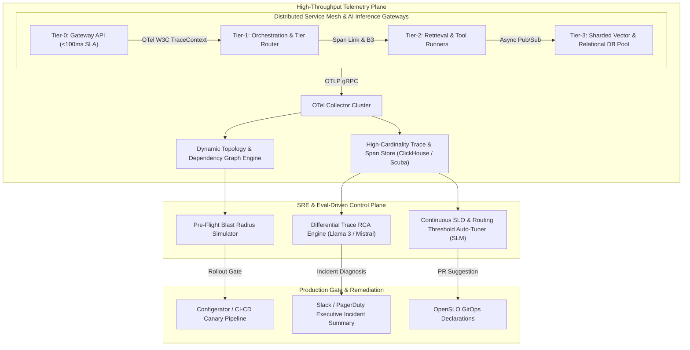
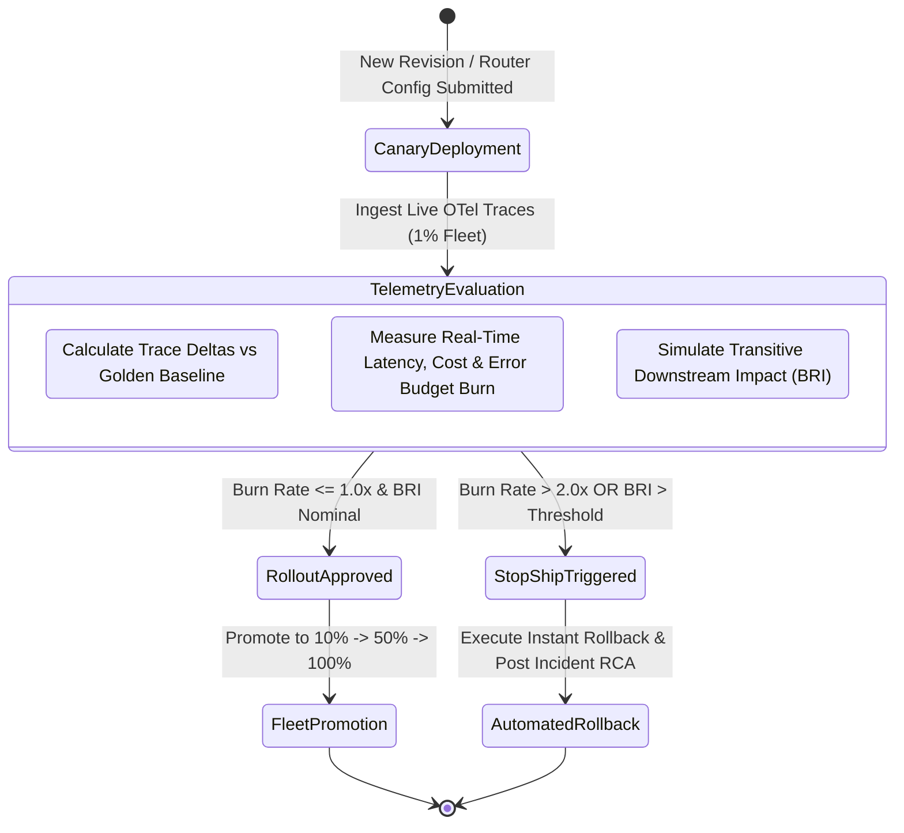

# Advanced Observability SRE: Service-Centric SLO Dependency & Blast Radius Engine

> **Enterprise reference architecture for real-time microservice and AI inference blast-radius estimation, OpenTelemetry span-link dependency graph generation, and differential trace root cause analysis at hyperscale.**

[](https://opentelemetry.io/)
[](#technical-architecture)
[](#2-differential-trace-root-cause-analysis-rca)
[](#sre-fundamental-closed-loop-error-budget-enforcement)
[](#faang-production-engineering-tool-mapping)
[](LICENSE)

---

## Executive Summary & Production Engineering Thesis

In large-scale distributed architectures spanning thousands of microservices and real-time AI inference pipelines, service degradation is non-linear. A fractional latency regression in a Tier-3 storage shard, or a prompt/routing change that triggers a 4x surge in agent tool retry loops, cascades through connection pools and backpressure buffers to cause brownouts in customer-facing Tier-0 APIs.

Traditional observability and offline evaluation paradigms fail at production scale:
- **Static Topology Maps:** Static architecture diagrams rot immediately in continuous-deployment environments where hundreds of daily canary pushes mutate call paths.
- **Offline Eval Blindness:** Static offline AI benchmarks (MMLU, HumanEval) pass in CI while minor prompt or model tier changes cause uncached token churn, retry storms, and latency SLA breaches under live traffic.
- **Disconnected Deployment Safety:** Rollout pipelines evaluate localized unit tests but lack visibility into the live, multi-hop systemic blast radius of a configuration or model routing push.

**Advanced Observability SRE** provides an autonomous, service-centric reliability control plane. Built on vendor-neutral **OpenTelemetry (OTel)** tracing primitives and informed by operating real-time platforms at ~1B monthly sessions under `< 100 ms` latency budgets, it dynamically reconstructs live dependency multigraphs, runs **Differential Trace Root Cause Analysis (RCA)**, and enforces pre-flight **Blast Radius Simulations** directly inside canary deployment pipelines to halt unsafe rollouts before error budgets are exhausted.

---

## Mathematical Formulation of Blast Radius

To quantify the systemic risk of an impending deployment, model routing shift, or degraded component, the framework models the platform as a directed dependency multigraph $G = (V, E, W)$:

$$\text{Blast Radius Index } (BRI) \text{ for service } S_k:$$

$$BRI(S_k) = \sum_{S_j \in \mathcal{D}(S_k)} w_{kj} \cdot \mathcal{C}(S_j) \cdot \left(\frac{\text{RPS}(S_j)}{\sum_{m \in V} \text{RPS}(S_m)}\right) \cdot \Delta \text{SLO}_{j}$$

Where:
- $\mathcal{D}(S_k)$ is the transitive closure of all downstream dependencies impacted by $S_k$.
- $w_{kj} \in [0, 1]$ represents the coupling elasticity (asynchronous queue / circuit-broken fallback vs. hard synchronous blocking RPC).
- $\mathcal{C}(S_j) \in \{1, 10, 100, 1000\}$ denotes the Tier criticality class (Tier-3 through Tier-0).
- $\text{RPS}(S_j)$ is the normalized request-per-second throughput volume.
- $\Delta \text{SLO}_j$ is the projected degradation delta against the service's published latency, availability, or token-cost SLO.

If $BRI(S_k) \times \tau_{\text{rollout}} > \text{Remaining Error Budget}(S_{\text{Tier-0}})$, the deployment pipeline asserts a **Fail-Closed Stop-Ship signal**.

---

## Technical Architecture



---

## Core Capabilities

### 1. Dynamic OTel-Driven Dependency Mapping
- Implements **W3C TraceContext** and **B3 Context Propagation** across synchronous RPCs, model gateway calls, and asynchronous messaging boundaries.
- Reconstructs real-time service dependency graphs by extracting parent-child span relationships and `SpanLinks` directly from live production telemetry.
- Detects hidden circular dependencies, retry amplification loops, and unintended transitive calls introduced by canary releases.

### 2. Differential Trace Root Cause Analysis (RCA)
- When a latency or cost-per-task SLO threshold is breached, the engine isolates a baseline of **Golden Traces** (nominal p50–p95 execution) and compares them against degraded canary traces.
- Generates deterministic trace deltas highlighting latency outliers, cache-miss cascades, error code distributions, and lock contention.
- Synthesizes a concise, operator-ready diagnosis:
  > *"Incident INC-842: Service `checkout-api` is breaching its p99 250ms latency SLO. Root cause: Downstream `inventory-db` shard #4 is experiencing lock contention following config change `#9812` (batch size increase from 100 to 5,000). Recommended mitigation: Roll back config revision `#9812`."*

### 3. Pre-Flight Blast Radius Simulation & Eval-Driven Canary Gates
- Integrated directly into canary rollout gates. Before code, prompt templates, or model routing thresholds propagate beyond 1% of fleet traffic, the engine simulates component degradation across the dependency multigraph.
- Computes whether retry amplification, prefix-cache invalidation, or tail-latency spikes will exhaust Tier-0 error budgets within the evaluation window.

### 4. Continuous SLM-Driven SLO Auto-Tuning
- Uses localized Small Language Models (SLMs) to analyze 30-day rolling latency and error distributions.
- Identifies overly tight thresholds causing alert fatigue and loose thresholds masking tail-latency degradation, submitting automated pull requests to update OpenSLO manifests.

---

## FAANG Production Engineering Tool Mapping

This architecture maps internal hyperscale Production Engineering tooling patterns (such as Meta's PE stack and Google's SRE ecosystem) to open cloud-native standards:

| Hyperscale Internal Tool (e.g. Meta) | Open-Source / Cloud-Native Equivalent | Role in Advanced Observability Platform |
| :--- | :--- | :--- |
| **Canopy** | OpenTelemetry Tracing + Jaeger / Tempo | End-to-end distributed tracing across microservice and inference boundaries. |
| **Scuba** | ClickHouse / Apache Pinot | Sub-second high-cardinality aggregation of multi-dimensional span data. |
| **Configerator** | ArgoCD / Flux + OpenSLO Gateways | Version-controlled configuration and routing rollout with automated health stops. |
| **FBAR (Auto-Remediation)** | Kubernetes Operators / Custom Controllers | Automated mitigation dispatch (drain, scale, circuit-break, canary revert). |
| **Service Mesh (SM)** | Envoy / Istio / Cilium eBPF | Uniform L7 traffic routing, complexity tiering, circuit breaking, and telemetry injection. |

---

## SRE Fundamental: Closed-Loop Error Budget Enforcement



### OpenSLO Policy Specification Example

```yaml
apiVersion: openslo/v1alpha
kind: SLO
metadata:
  name: checkout-latency-tier0
  displayName: Checkout Service Tier-0 Latency SLO
spec:
  service: checkout-service
  description: 99.0% of requests must complete in under 250ms over a rolling 30-day window
  budgetingMethod: Occurrences
  objectives:
    - target: 0.99
      timeSliceWindow: 5m
      indicator:
        metadata:
          name: otel_grpc_server_duration_ms
        spec:
          ratioMetrics:
            total:
              metricSource:
                spec:
                  query: sum(rate(rpc_server_duration_count{service="checkout"}[5m]))
            good:
              metricSource:
                spec:
                  query: sum(rate(rpc_server_duration_bucket{service="checkout", le="250"}[5m]))
  alertPolicies:
    - name: blast-radius-canary-block
      conditions:
        - kind: BurnRate
          op: gt
          value: 2.5
          period: 15m
```

### Pre-Flight Blast Radius CI/CD Gate (GitHub Actions / ArgoCD)

```yaml
# .github/workflows/canary-blast-gate.yml
name: Pre-Flight Blast Radius Canary Gate

on:
  deployment_status:

jobs:
  evaluate-blast-radius:
    if: github.event.deployment_status.state == 'in_progress'
    runs-on: ubuntu-latest
    steps:
      - name: Ingest Canary OTel Traces & Run Blast Simulation
        run: |
          python -m blast_radius.simulate \
            --service "checkout-api" \
            --canary-pct 0.01 \
            --eval-window 15m \
            --max-allowed-bri 12.5 \
            --fail-closed
      - name: Enforce Stop-Ship if Blast Radius Breaches Error Budget
        if: failure()
        run: |
          curl -X POST https://argocd.internal/api/v1/rollbacks \
            -H "Authorization: Bearer ${{ secrets.ARGOCD_TOKEN }}" \
            -d '{"app": "checkout-api", "reason": "BRI breached Tier-0 error budget"}'
```

### Differential Trace Delta Diagnostic Output

```text
-----------------------------------------------------------------
DIFFERENTIAL TRACE DELTA ANALYSIS (Canary Gate Evaluation)
-----------------------------------------------------------------
Canary Window:       15m (1% Fleet Traffic | 1,420 RPS)
Golden Baseline:     p50: 42ms | p95: 110ms | p99: 185ms (0.01% err)
Canary Active:       p50: 48ms | p95: 340ms | p99: 1,890ms (1.84% err)
Root Span Delta:     checkout-service -> inventory-service -> postgres-pool
Lock Anomaly:        postgres-pool acquisition latency surged 14.8x.
Pre-Flight BRI:      BRI = 48.2 (Exceeds maximum safe threshold of 12.5).
Policy Action:       Deployment HALTED. Automated canary rollback dispatched.
-----------------------------------------------------------------
```

---

## Repository Topology

```text
advanced-observability-sre/
├── README.md               # Executive Architecture & Production Engineering Specification
├── PROPOSAL.md             # Original RFC & Technical Motivation
└── docs/                   # Deep-dive whitepapers & SLO design guides
```

---

## License & Contact

Distributed under the **MIT License**. Maintained by **Hooman Parta** ([@hoomanp](https://github.com/hoomanp)).
